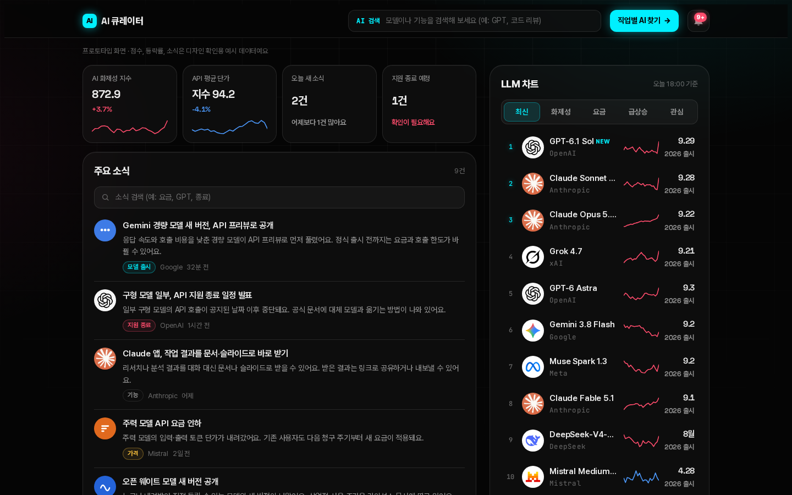
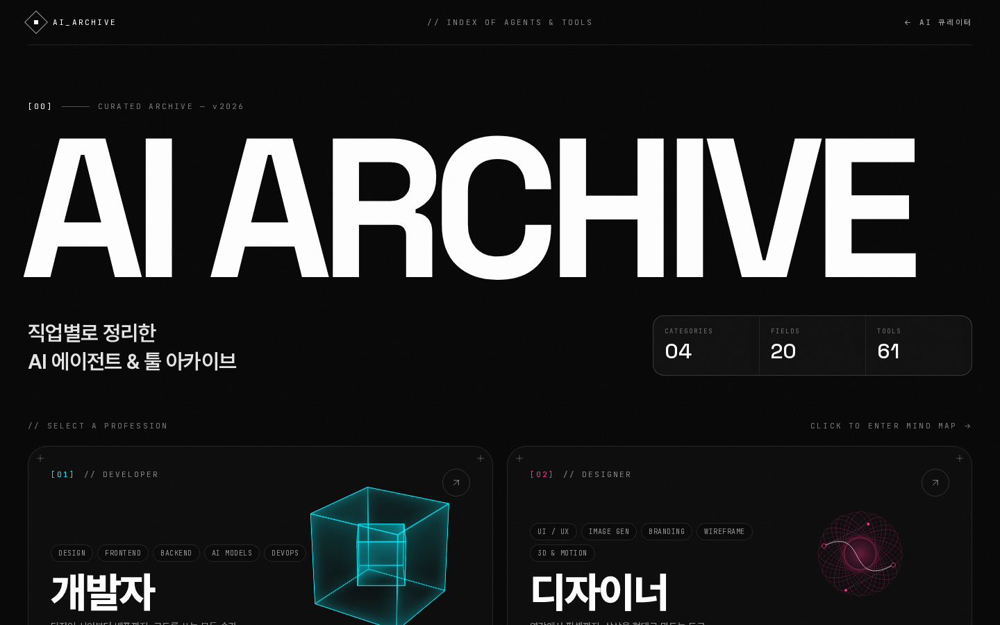
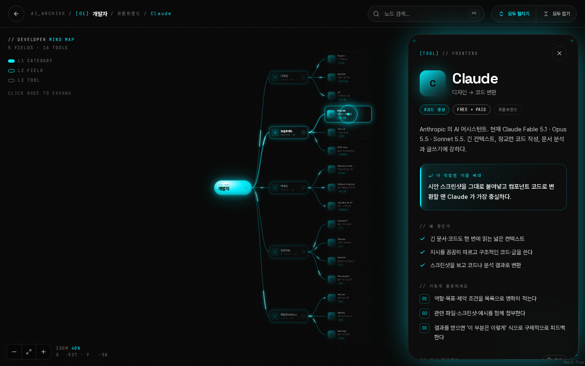

# AI 큐레이터 + AI ARCHIVE

AI 소식과 모델을 한눈에 보는 **AI 큐레이터**와, 직업별로 쓸 만한 AI 툴을 마인드맵으로 정리한 **AI ARCHIVE**를 한 저장소에 담았어요. 두 사이트는 서로 링크로 이어져 있어요.

| AI 큐레이터 | AI ARCHIVE | 마인드맵 |
|---|---|---|
|  |  |  |

배포된 사이트: [AI 큐레이터](https://ai-curator-ten.vercel.app) · [AI ARCHIVE](https://ai-archive-weld.vercel.app)

## 바로 실행하기

필요한 것: [Node.js](https://nodejs.org) 20.9 이상 (npm 포함)

```bash
git clone <이 저장소 주소>
cd ai-curator-archive
npm install      # AI ARCHIVE 패키지까지 한 번에 설치돼요
npm run dev      # 두 사이트를 동시에 실행
```

- AI 큐레이터 → http://localhost:3001
- AI ARCHIVE → http://localhost:3000

두 사이트 사이의 이동 버튼(큐레이터의 "직업별 AI 찾기", ARCHIVE의 "← AI 큐레이터")은 내 컴퓨터에서 실행하면 자동으로 위의 로컬 주소로 연결돼요.

| 명령 | 하는 일 |
|---|---|
| `npm run dev` | 개발 모드로 두 사이트 실행 (코드 고치면 바로 반영) |
| `npm run build` | AI ARCHIVE 배포용 빌드 |
| `npm run start` | 빌드한 결과로 두 사이트 실행 |

## 무엇이 들어 있나요

### AI 큐레이터 (`curator/`)
HTML·CSS·JavaScript만으로 된 정적 사이트예요. 빌드 과정이 없어요.

- **LLM 차트**: 최신 · 화제성 · 요금(API / 무료 / Pro / Max) · 급상승(OpenRouter 사용량) · 관심
- **AI 진화 타임라인**: GPT, Claude, Gemini, Llama·Muse, DeepSeek, Mistral, Grok 7개 계열의 출시 기록 (항목마다 공식 출처 링크)
- **검색**: 모델·계열 자동완성, 주요 소식과 같은 카테고리 탭, 주요 소식 안 검색창
- **알림함**: 최근 30일 출시·업데이트 소식

### AI ARCHIVE (`archive/`)
Next.js 16 + TypeScript + Tailwind CSS + Framer Motion + React Flow로 만든 사이트예요.

- 개발자 · 디자이너 · 공부 · 영상 편집 4개 직업별 AI 툴 54개
- 분야 → 툴로 펼쳐지는 마인드맵, ⌘K 검색
- 툴마다 왜 좋은지 · 활용법 · 바로 쓸 수 있는 예시 프롬프트(복사 버튼)

## 데이터 고치기

코드는 건드리지 않고 데이터 파일만 고치면 화면에 반영돼요.

| 바꾸고 싶은 것 | 파일 |
|---|---|
| ARCHIVE의 직업·분야·툴·프롬프트 | `archive/data/archive.ts` |
| 큐레이터의 차트 모델·API 요금 | `curator/js/data.js` → `MODELS` |
| AI 진화 타임라인 · 계열 · 검색 별명 | `curator/js/data.js` → `TIMELINES`, `FAMILIES` |
| 구독 요금 (무료·Pro·Max) | `curator/js/data.js` → `SUBSCRIPTIONS` |
| 급상승 (OpenRouter 사용량) | `curator/js/data.js` → `TRENDING` |
| 주요 소식 | `curator/js/data.js` → `NEWS` |

**실제 데이터와 예시 데이터**
- 실제 데이터(2026-09-30 기준 · 출처 링크 포함): 진화 타임라인, 차트 모델 정보, API·구독 요금, 급상승, ARCHIVE 툴 정보
- 예시 데이터(디자인 확인용): 큐레이터의 화제성 점수·등락률, 주요 소식, 작업물, 상단 지수 카드 — 화면에 `예시` 표시가 있어요

AI는 빨리 바뀌니까 요금·모델·급상승은 주기적으로 갱신해 주세요. 각 데이터 위에 기준 날짜(`TIMELINE_CHECKED`, `ARCHIVE_CHECKED`, `TRENDING.checked`)가 있어요.

## 배포하기 (Vercel 예시)

두 사이트를 각각 별도 프로젝트로 올려요.

| 사이트 | Root Directory | 빌드 |
|---|---|---|
| AI ARCHIVE | `archive` | 자동 감지 (Next.js) |
| AI 큐레이터 | `curator` | 없음 (정적 파일) |

배포 후 서로의 주소를 바꾸려면:
- ARCHIVE → 큐레이터: 환경 변수 `NEXT_PUBLIC_CURATOR_URL`에 큐레이터 주소를 넣고 다시 빌드
- 큐레이터 → ARCHIVE: `curator/js/app.js` 맨 위 `ARCHIVE_URL`의 배포 주소를 수정

## 키오스크 모드 (라즈베리파이 터치 화면)

AI ARCHIVE 앱 하나가 키오스크 전체를 보여 줘요. 큐레이터는 빌드할 때 `archive/public/news`로 자동 복사돼서 `/news/`에서 열려요.

| 주소 | 화면 |
|---|---|
| `/kiosk` | 시작 화면: "AI 소식" · "작업별 AI 기능 추천" 두 버튼 |
| `/news/` | AI 큐레이터 |
| `/` | AI ARCHIVE |
| `/admin` | 관리자 분석 페이지 (로그인 필요) |

- 키오스크 모드에서는 화면 아래에 **[처음으로] [설문 참여]** 버튼이 떠요. 2분 동안 조작이 없으면 첫 화면으로 돌아가요.
- 설문 13문항(`archive/public/kiosk/questions.json`에서 수정), 화면 키보드(한/영/숫자) 내장, 끝나면 경품 추첨 응모(전화번호는 설문과 연결하지 않고 따로 저장).
- 기록: 페이지 이동·머문 시간·클릭·설문을 어느 페이지에서 열었는지 → Supabase에 저장 → `/admin`에서 비교 분석, CSV 내려받기.
- 일반 브라우저로 볼 때는 키오스크 기능이 꺼져 있어요. `?kiosk=1`로 켜고 `?kiosk=0`으로 꺼요.

### 1) Supabase 준비
1. [supabase.com](https://supabase.com)에서 새 프로젝트 만들기 (지역: Seoul)
2. SQL Editor에 `kiosk/supabase.sql` 전체를 붙여넣고, 맨 아래 `admin@example.com`을 관리자 이메일로 바꾼 뒤 Run
3. Authentication → Users → Add user로 그 이메일의 관리자 계정 만들기, Sign In / Providers에서 회원가입(Allow new users to sign up) 끄기
4. Project Settings → API에서 **Project URL**과 **anon public** 키를 복사 (service_role 키는 절대 넣지 마세요)

anon 키는 브라우저에 공개되지만, 권한 설정으로 "쓰기만" 가능하고 읽기는 관리자만 할 수 있어요.

### 2) 환경 변수
`archive/.env.example`을 `archive/.env.local`로 복사해서 값을 채우세요. Vercel에 올릴 때는 같은 이름으로 Environment Variables에 넣어요.

### 3) 배포
Vercel에서 이 저장소로 새 프로젝트를 만들고 **Root Directory를 `archive`**로, "Include files outside of the root directory"를 켜 두세요(빌드 때 `../curator`를 복사해요).

### 4) 라즈베리파이
파이에서 터미널을 열고:

```bash
curl -O https://raw.githubusercontent.com/wonhyuk12/ai-curator-archive/main/kiosk/setup-pi.sh
bash setup-pi.sh https://내-배포-주소/kiosk
sudo reboot
```

부팅하면 Chromium이 전체 화면 키오스크로 열려요(꺼져도 자동 재시작, 화면 꺼짐·페이지 확대·스와이프 뒤로가기 끔). 해제는 `bash setup-pi.sh --uninstall`.

## 문제 해결

- **포트가 이미 사용 중이라고 나와요**: 3000이나 3001을 다른 프로그램이 쓰고 있어요. 그 프로그램을 끄거나, 루트 `package.json`의 `3001`과 `archive/components/landing/Landing.tsx`·`curator/js/app.js`의 로컬 주소를 같이 바꿔 주세요.
- **`npm install` 후 ARCHIVE 패키지가 없어요**: `npm install --prefix archive`를 한 번 더 실행하세요.
